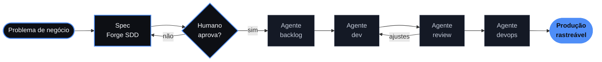

  

  
  
  
  

🇧🇷 Português · <a href="#-english">🇺🇸 English</a>

---

### Eu transformo problema de negócio em sistema rodando, e a IA já faz parte de como a entrega acontece.

Arquiteto de soluções e tech lead na **DTI Digital**, com mais de 5 anos liderando times em ambientes corporativos de governança forte. Na **Busize**, minha consultoria, levo operação, automação e IA aplicada para empresas menores.

Meu foco não é a linguagem nem o framework. É **chegar ao resultado com previsibilidade**: spec antes do código, agentes fazendo o trabalho repetitivo, humano decidindo o que importa, e tudo rastreável.

<table>
<tr>
<td align="center" width="25%"><h3>🧭</h3><b>Arquitetura</b> soluções em nuvem que cabem no orçamento e na governança</td>
<td align="center" width="25%"><h3>🤖</h3><b>Operação com IA</b> pipelines de agentes do backlog ao deploy</td>
<td align="center" width="25%"><h3>⚙️</h3><b>Automação</b> processos manuais que viram rotina de máquina</td>
<td align="center" width="25%"><h3>👥</h3><b>Liderança técnica</b> times que entregam com método, não com heroísmo</td>
</tr>
</table>

---

## 🔁 Como uma entrega acontece

> O GitHub Project é o board oficial: cada card é uma spec, e cada agente só começa quando o card chega na coluna dele.

---

## 🛠️ Ferramentas que construí

| | Ferramenta | Problema que resolve | Como resolve |
|:-:|---|---|---|
| ⚒️ | **[Forge SDD](https://github.com/nathanramorim/forge-sdd)** open source · npm | IA gerando código sem contexto, e cada projeto com um jeito diferente | Metodologia de **Spec Driven Development**: constitution, discovery e specs que guiam humanos e agentes, com variantes para Next.js, React + Vite e Node |
| 📄 | **[readme-studio](https://github.com/nathanramorim/readme-studio)** open source · MIT | README sem padrão, que não vende o projeto | Plugin para Claude Code e skill para agy: lê o projeto, gera banner com a marca, selos e tabela de versões, e só grava depois do seu "sim" |
| 🗂️ | **[drive-hub-sync](https://github.com/nathanramorim/drive-hub-sync)** open source · MIT | Documentação de cada projeto espalhada, sem visão do todo | Gera a documentação do projeto e sincroniza uma estrutura padrão no Google Drive, pronta para o NotebookLM conhecer todos os projetos. Código e segredos nunca sobem |
| 🎛️ | **Orquestrador de agentes** CLI · em construção | Coordenar vários agentes sem perder custo e status de vista | Pipeline backlog → dev → review → devops no terminal, com painel de custo e execução |
| 🏢 | **Hub de operação** interno · em construção | Vários clientes em paralelo, cada um com repositórios, documentos e pendências espalhados | Repositório central que conhece todos os projetos, lê do GitHub sob demanda e transforma cada entrega em conhecimento reutilizável |
| 💬 | **Agente replicável por nicho** produto · em construção | Pequenos negócios querem IA, mas não um projeto sob medida | Núcleo fixo com MCP e APIs do cliente, mais uma pasta de configuração por cliente, rodando em container |

---

## ⚖️ Decisões de arquitetura

Prefiro mostrar **como decido** a listar o que sei usar. Algumas decisões reais, resumidas no formato ADR:

<b>ADR 01 · Agentes de código rodam local; agentes de texto passam por gateway</b>

 

| Contexto | Decisão | Trade off | Resultado |
|---|---|---|---|
| Pipeline com 4 agentes e modelos diferentes por etapa | Backlog e review chamam a **OpenRouter**; dev e devops rodam o **Claude Code na máquina**, autenticados direto no provedor | Duas formas de autenticação para manter | O código não sai do ambiente controlado, e as etapas de texto ficam livres para trocar de modelo por custo |

<b>ADR 02 · O board é a fonte da verdade, não o agente</b>

 

| Contexto | Decisão | Trade off | Resultado |
|---|---|---|---|
| Agentes autônomos tendem a "decidir sozinhos" o que fazer | **GitHub Project** como board canônico: a spec vive na issue e o agente dev só executa com status `ready` | Menos autonomia dos agentes | Cada passo é auditável, e o humano para o fluxo movendo um card |

<b>ADR 03 · Conhecimento sob demanda, não contexto gigante</b>

 

| Contexto | Decisão | Trade off | Resultado |
|---|---|---|---|
| Prompts inchados com todas as boas práticas a cada chamada | **Índice roteável** (`INDEX.md`) que aponta para o arquivo certo conforme a tarefa | Exige curadoria do índice | Menos token por tarefa e respostas mais consistentes |

<b>ADR 04 · Produto replicável = núcleo fixo + configuração por cliente</b>

 

| Contexto | Decisão | Trade off | Resultado |
|---|---|---|---|
| Cada cliente pedindo "o seu agente" | Um **núcleo único** em container e uma **pasta de config** com contexto, ferramentas e MCP de cada cliente | Customização profunda fica limitada | Cliente novo vira configuração, não projeto |

<b>ADR 05 · Recomeçar do zero quando o custo de consertar é maior</b>

 

| Contexto | Decisão | Trade off | Resultado |
|---|---|---|---|
| Hub antigo de clientes com estrutura que não escalava | Criar um **repositório novo** a partir de constitution e discovery do Forge SDD, migrando os projetos depois | Retrabalho de migração | Base limpa, documentada e pronta para crescer |

### Meus princípios de decisão

| Princípio | Na prática |
|---|---|
| 🔐 **Governança primeiro** | Toda ferramenta passa por licença, segurança e tratamento de dados antes de entrar |
| 📝 **Spec antes de código** | Se não está escrito, nem humano nem agente começa |
| 💰 **Custo é requisito** | Arquitetura que cabe no orçamento, e custo zero quando dá |
| 🎯 **Contexto mínimo** | Agente recebe só o que precisa: menos token, menos erro |
| 🔁 **Replicável por padrão** | O que funciona para um cliente vira template para o próximo |
| 🙋 **Humano no loop** | Agente executa, pessoa decide |

---

## 📈 Cases

| Desafio | Abordagem | Entrega |
|---|---|---|
| **Escritório contábil com mais de 1000 clientes** baixando arquivos fiscais um a um | Automação do download em massa via procuração eletrônica | Download em lote e automatizado, no lugar do processo cliente a cliente |
| **Rede de autopeças com cerca de 12 filiais** precisando trocar de ERP | Levantamento de processos, critérios de governança e comparação de fornecedores | Decisão de ERP baseada em critério, não em demo |
| **Sistema SaaS prestes a entrar em produção** | Auditoria de segurança, riscos e infraestrutura antes do go live | Lista priorizada de riscos e plano de correção antes do primeiro cliente |

---

## 📚 Conteúdo

Publico a série **AI Engineering** no [LinkedIn](https://www.linkedin.com/in/nathanramorim), sobre as três camadas de quem trabalha sério com IA:

**Prompt Engineering** → **Context Engineering** → **Harness Engineering**

---

<b>🇺🇸 English</b>

 

### I turn business problems into running systems, with AI built into how delivery happens.

Solutions Architect and Tech Lead at **DTI Digital**, with 5+ years leading teams in enterprise environments with strong governance. Through **Busize**, my consultancy, I bring operations, automation and applied AI to smaller businesses.

I don't sell a language or a framework. I sell **predictable outcomes**: spec before code, agents doing the repetitive work, humans making the calls that matter, and everything traceable.

**What I've built**

| Tool | What it does |
|---|---|
| **[Forge SDD](https://github.com/nathanramorim/forge-sdd)** | Open source Spec Driven Development methodology that guides both humans and AI agents |
| **[readme-studio](https://github.com/nathanramorim/readme-studio)** | Claude Code plugin that generates a branded, standardized README from your project |
| **[drive-hub-sync](https://github.com/nathanramorim/drive-hub-sync)** | Generates project docs and syncs a standard structure to Google Drive, ready for NotebookLM. Code and secrets never leave |
| **Agent orchestrator** *(WIP)* | Terminal pipeline backlog → dev → review → devops with cost and execution dashboards |
| **Operations hub** *(WIP)* | Central repo that knows every client project and turns each delivery into reusable knowledge |
| **Niche agent product** *(WIP)* | Fixed core with MCP and client APIs, configured per customer, running in containers |

**How I decide:** governance first · spec before code · cost is a requirement · minimal context · replicable by default · human in the loop.

---

  Stack é meio, não fim. Hoje trabalho principalmente com .NET, TypeScript, Python e Azure, e escolho o que o problema pede.

