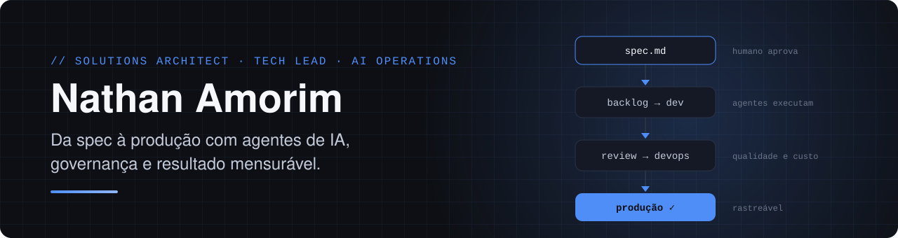
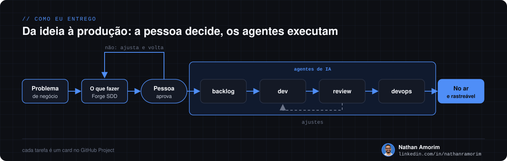
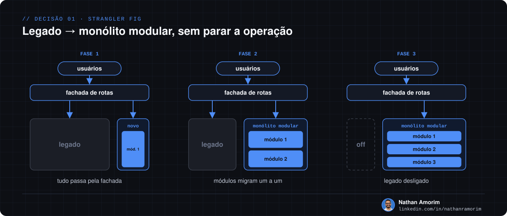
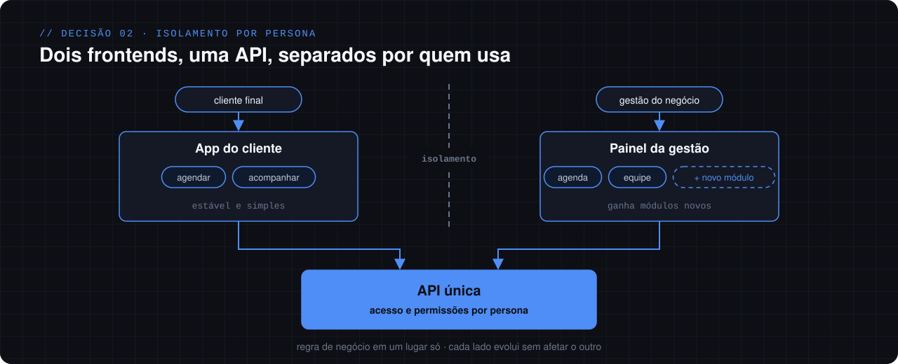
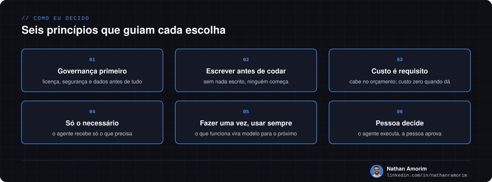
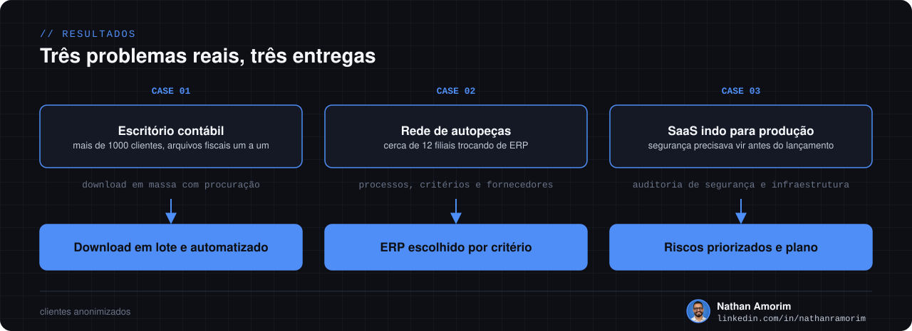

  

  
  
  
  

🇧🇷 Português · <a href="#-english">🇺🇸 English</a>

---

### Transformo problema de negócio em sistema funcionando, usando IA no jeito de entregar.

Arquiteto de soluções e tech lead na **DTI Digital**, com mais de 5 anos liderando times em empresas com regras fortes de segurança e governança. Na **Busize**, minha consultoria, levo operação, automação e IA aplicada para empresas menores.

Meu foco não é a linguagem. É **entregar resultado sem surpresa**: primeiro escrevo o que vai ser feito, os agentes de IA fazem o trabalho repetitivo, e as pessoas decidem o que importa.

<table>
<tr>
<td align="center" width="25%"><h3>🧭</h3><b>Arquitetura</b> soluções em nuvem que cabem no orçamento e na governança</td>
<td align="center" width="25%"><h3>🤖</h3><b>Operação com IA</b> agentes que vão da tarefa ao deploy</td>
<td align="center" width="25%"><h3>⚙️</h3><b>Automação</b> trabalho manual que passa a rodar sozinho</td>
<td align="center" width="25%"><h3>👥</h3><b>Liderança técnica</b> times que entregam com método, não com heroísmo</td>
</tr>
</table>

---

## 🔁 Como uma entrega acontece

---

## 🛠️ Ferramentas que construí

| | Ferramenta | Problema que resolve | Como resolve |
|:-:|---|---|---|
| ⚒️ | **[Forge SDD](https://github.com/nathanramorim/forge-sdd)** open source · npm | IA escrevendo código sem saber o que o projeto quer, e cada projeto de um jeito | Metodologia de **Spec Driven Development**: documentos curtos que dizem o que construir e como, e guiam pessoas e agentes |
| 📄 | **[readme-studio](https://github.com/nathanramorim/readme-studio)** open source · MIT | README sem padrão, que não vende o projeto | Plugin para Claude Code e skill para agy: lê o projeto, gera banner com a marca, selos e tabela de versões, e só grava depois do seu "sim" |
| 🗂️ | **[drive-hub-sync](https://github.com/nathanramorim/drive-hub-sync)** open source · MIT | Documentação de cada projeto espalhada, sem visão do todo | Gera a documentação do projeto e sincroniza uma estrutura padrão no Google Drive, pronta para o NotebookLM conhecer todos os projetos. Código e segredos nunca sobem |
| 📐 | **[diagram-studio](https://github.com/nathanramorim/diagram-studio)** open source · MIT | Diagrama técnico feio, desalinhado e cada um num estilo | Plugin para Claude Code e skill para agy: você descreve, ele gera SVG e PNG com setas retas, texto que cabe e assinatura. Os diagramas desta página saíram dele |
| 💬 | **Agente replicável por nicho** produto · em construção | Pequenos negócios querem IA, mas não um projeto sob medida | Um núcleo igual para todos e uma pasta de configuração por cliente. Cliente novo vira configuração, não projeto |

---

## ⚖️ Decisões de arquitetura

Duas decisões reais, contadas de forma simples. Os clientes estão anonimizados.

### 1. Trocar o legado sem desligar a operação

| | |
|---|---|
| 🧩 **O desafio** | Uma plataforma de planejamento de um cliente B2B rodava num sistema legado que precisava evoluir, mas a operação não podia parar. |
| ✅ **A decisão** | Migrar para um **monólito modular** usando **estrangulamento** (Strangler Fig). Uma fachada recebe todas as chamadas e decide, rota por rota, se vai para o legado ou para o módulo novo. |
| 💡 **Por quê** | Cada parte migra separada, com teste e com volta fácil se algo der errado. O usuário não percebe a troca. E os módulos nascem com fronteiras claras, num deploy só. |

### 2. Dois frontends e uma API, separados por quem usa

| | |
|---|---|
| 🧩 **O desafio** | Num app de agendamento, o cliente final precisa de algo simples e sempre no ar. A gestão do negócio precisa ganhar módulos novos o tempo todo. |
| ✅ **A decisão** | **Dois frontends**, um para cada persona, falando com **uma única API** que controla o acesso de cada um. |
| 💡 **Por quê** | O app do cliente continua funcionando enquanto a gestão evolui, sem medo de impacto. A regra de negócio fica em um lugar só: a API. |

### Meus princípios de decisão

---

## 📈 Cases

---

## 📚 Conteúdo

Publico a série **AI Engineering** no [LinkedIn](https://www.linkedin.com/in/nathanramorim), sobre as três camadas para usar IA a sério no trabalho:

**Prompt Engineering** → **Context Engineering** → **Harness Engineering**

### 🎙️ Podcasts

| Episódio | Programa |
|---|---|
| [Como a crise do open source muda suas escolhas técnicas](https://open.spotify.com/episode/2BZUdIccCJrxy4DgqQjmYn) | Entre Chaves #292 · 2026 |
| [Por que pessoas técnicas não podem mais ignorar operações](https://open.spotify.com/episode/11H0GtDjatmPrd60WOKmY6) | Entre Chaves #145 · 2023 |

---

<b>🇺🇸 English</b>

 

### I turn business problems into running systems, with AI built into how delivery happens.

Solutions Architect and Tech Lead at **DTI Digital**, with 5+ years leading teams in enterprise environments with strong governance. Through **Busize**, my consultancy, I bring operations, automation and applied AI to smaller businesses.

My focus isn't the language. It's **delivering without surprises**: write down what will be built first, let AI agents do the repetitive work, and keep people making the calls that matter.

**What I've built**

| Tool | What it does |
|---|---|
| **[Forge SDD](https://github.com/nathanramorim/forge-sdd)** | Open source Spec Driven Development methodology that guides both humans and AI agents |
| **[readme-studio](https://github.com/nathanramorim/readme-studio)** | Claude Code plugin that generates a branded, standardized README from your project |
| **[drive-hub-sync](https://github.com/nathanramorim/drive-hub-sync)** | Generates project docs and syncs a standard structure to Google Drive, ready for NotebookLM. Code and secrets never leave |
| **[diagram-studio](https://github.com/nathanramorim/diagram-studio)** | Claude Code plugin that turns a short JSON into clean SVG and PNG technical diagrams, with your signature |
| **Niche agent product** *(WIP)* | Same core for everyone, one config folder per customer |

**Architecture decisions:** legacy to modular monolith with the Strangler Fig pattern, without stopping operations · two frontends and one API, isolated by persona, so the customer app stays stable while the back office grows.

**Podcasts (pt-BR):** [open source crisis and technical choices](https://open.spotify.com/episode/2BZUdIccCJrxy4DgqQjmYn) · [why technical people can no longer ignore operations](https://open.spotify.com/episode/11H0GtDjatmPrd60WOKmY6), both on Entre Chaves.

**How I decide:** governance first · spec before code · cost is a requirement · minimal context · replicable by default · human in the loop.

---

  Stack é meio, não fim. Hoje trabalho principalmente com .NET, TypeScript, Python e Azure, e escolho o que o problema pede.

